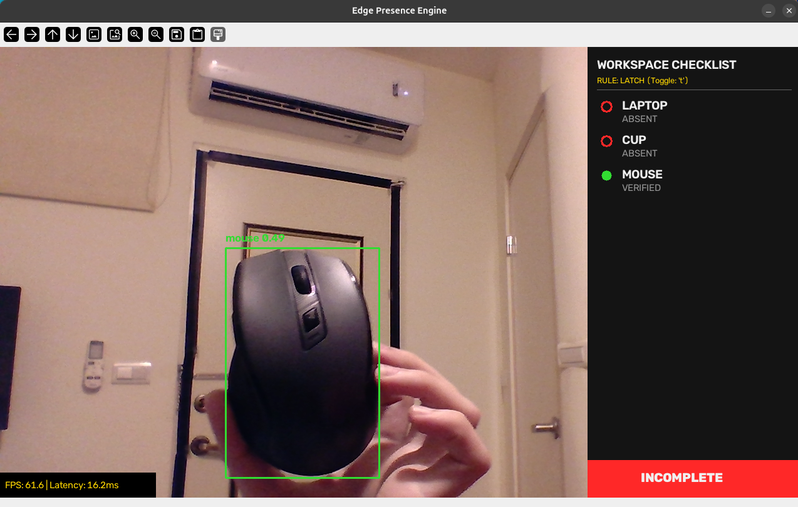

# Dynamic Edge Presence Verification Engine

This repository contains a local computer vision pipeline that verifies the physical presence of specific objects at a workstation. It tracks items in real-time and uses a temporal state machine to handle occlusions and false positives. 

The project is a Proof of Concept for the Battlefield Lightning Track of the 2026 ASUS UGen AI League Hackathon. It is designed as a software backbone that will eventually be compiled for the ASUS UGen300 (Hailo-10H NPU). Currently, it runs locally on an RTX 4050 (6GB VRAM) and maintains a VRAM footprint of roughly 1.6GB.



## Architecture and Performance

The engine handles object localization through two different pathways depending on whether the target object can be easily described with standard vocabulary.

The primary pathway uses YOLO-World for text-prompted detection. The target objects are defined in a YAML configuration file. During initialization, the model calculates the text embeddings and injects them directly into the RepVL-PAN weights in memory. Because it runs as a standard feed-forward network without calculating text embeddings on every frame, this mode achieves roughly 40 to 60 FPS on the RTX 4050.

The secondary pathway uses YOLOE (with SAVPE) for few-shot visual prompting, allowing the system to track custom or unbranded hardware. Users select a Region of Interest directly from the live camera feed. To mitigate the heavy computational cost of processing both a live feed and a reference image simultaneously, the reference ROI is statically downscaled to a 320x320 tensor. Even with this optimization, the dual-encoder architecture and segmentation overhead limit this mode to approximately 7 FPS on the current hardware.

Outputs from either model are piped into a temporal tracker. The state machine requires an object to be detected for a consecutive number of frames (the debounce threshold) before marking it as verified, preventing the UI from flickering due to single-frame noise.

## Installation

Ensure you have a working Python 3.11 environment and NVIDIA drivers compatible with CUDA 13.0. 

```bash
uv venv .venv --python 3.11
source .venv/bin/activate

uv pip install torch torchvision
uv pip install -r requirements.txt

```

## Running the Engine

Three bash scripts are provided to execute the different components of the project.

### demo_text_mode.sh

This script launches the engine in text mode. By default, it is configured to look for a laptop, a cup, and a mouse using cumulative latching (once an item is verified, it stays verified). You can switch the logic to simultaneous verification by pressing `t` in the OpenCV window, which forces the system to require all items to be in the frame at the exact same time.
* Execute `bash demo_text_mode.sh` to launch the engine.

### demo_visual_mode.sh

This script launches the engine in visual mode. When the camera feed opens, hold an object in front of the lens and press `v`. The feed will freeze, allowing you to drag a bounding box over the object. Press Enter to confirm the selection. The system will use that crop as the visual prompt and begin tracking the object.
* Execute `bash demo_visual_mode.sh` to launch the engine.

### demo_calibration.sh

This is a standard OpenCV capture script that saves frames from your webcam to a local directory (`assets/calibration_1024`). It is included to quickly record a dataset of the target workstation environment. This specific dataset size is required by the Hailo Dataflow Compiler to run INT8 Post-Training Quantization (PTQ) for the hypothetical Stage II hardware migration.
* Execute `bash demo_calibration.sh` to launch the engine.

## Interface Controls

When the OpenCV window is active, the following hotkeys are available:

* `q` - Quit the application
* `t` - Toggle between Simultaneous and Latch state machine rules
* `c` - Clear the state machine and reset all verified items
* `v` - Open the bounding box selector for visual prompting (only works in visual mode)
* `r` - Reload the `workstation.yaml` file to update text classes without restarting the script (only works in text mode)
